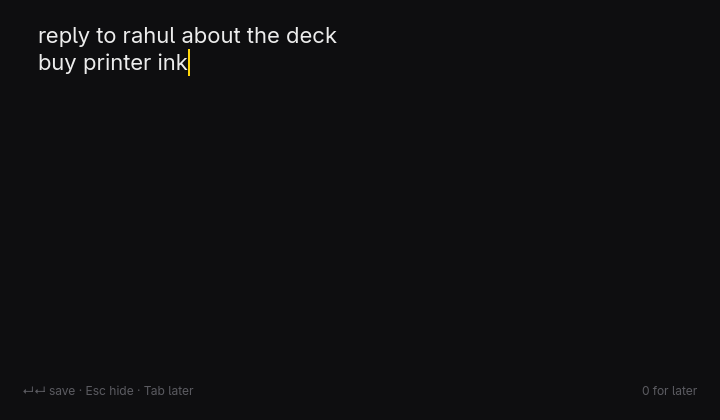

# Lightswitch




Don't multitask: dump the thought and get back to work. Press **Super + N**,
type, press **Enter twice**, and it's gone. Flip it on, flip it off.

Everything you dumped is in the **notes window** (open Lightswitch from the
app launcher, or Ctrl+L from the capture box): grouped by day, with Open /
Done / All, search, edit, delete, and undo.

Notes go to `~/Notes/lightswitch.md` as a plain Markdown checklist
(`- [ ] 2026-11-22 14:03 · call the bank`), so any editor can read them.

## Why it's fast

Lightswitch stays resident with its window hidden (started on login with
`lightswitch daemon`). Super + N runs `lightswitch-toggle`, a libc-only client
that pokes the resident app over a Unix socket in about a millisecond, so the
window is a show, not a launch.

## Shortcuts

**Capture box (Super + N)**

| Key | Does |
| --- | --- |
| Super + N | Show / hide |
| Enter | Next note (each line is one note) |
| Enter twice | Save everything and hide |
| Shift + Enter | Line break inside a note |
| Esc, or click away | Hide, keep the draft |
| Ctrl + L | Open the notes window |

**Notes window**

| Key | Does |
| --- | --- |
| J / K, arrows | Move |
| Space, X | Done / not done |
| E, Enter, double-click | Edit |
| D, Delete | Delete |
| Ctrl + Z | Undo |
| /, Ctrl + F | Search |
| 1 2 3 | Open, done, all |
| N, Ctrl + N | New note (capture box) |
| Ctrl + O | Open the Markdown file |
| ? | All keys |
| Esc | Hide |

## Commands

```sh
lightswitch                 # show/hide (starts it if needed)
lightswitch open            # the notes window
lightswitch add "call bank" # save without the window
lightswitch list [--json]   # print open notes
lightswitch path            # notes file
lightswitch quit            # stop the resident app
```

## Build

```sh
bin/build     # build/lightswitch and build/lightswitch-toggle
bin/test      # backend tests, offscreen
bin/install   # makepkg -fsi, then restarts the resident copy
```
