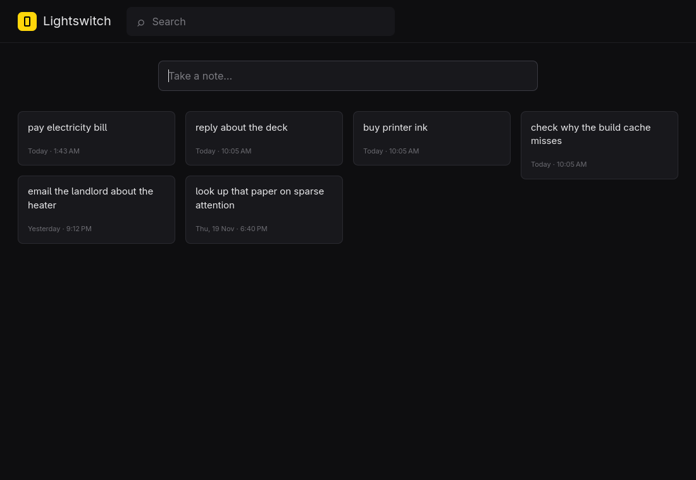

# Lightswitch




Don't multitask: dump the thought and get back to work. Press **Super + N**,
type, press **Enter twice**, and it's gone. Flip it on, flip it off.

Open Lightswitch from the app menu to see every note as a card (like Google
Keep): click to edit, hover for done or delete, search at the top. Tab in the
quick editor jumps there too.

Notes go to `~/Notes/lightswitch.md` as a plain Markdown checklist
(`- [ ] 2026-11-22 14:03 · call the bank`), so any editor can read them.

## Install

Download from [Releases](../../releases/latest):

- **Arch / Omarchy:** `sudo pacman -U lightswitch-0.1.0-1-x86_64.pkg.tar.zst`
- **Other Linux (Qt 6, Wayland):** unpack `lightswitch-0.1.0-linux-x86_64.tar.gz`, run `./install.sh`
- **Android 8+:** install `lightswitch-0.1.0.apk`, open it, tap **Allow**

Then bind a key to `lightswitch-toggle` and autostart `lightswitch daemon`. On
Omarchy:

```lua
-- ~/.config/hypr/bindings.lua
o.bind("SUPER + N", "Lightswitch", "lightswitch-toggle")
-- ~/.config/hypr/autostart.lua
o.launch_on_start("lightswitch daemon")
-- ~/.config/hypr/hyprland.lua
o.window({ class = "lightswitch", title = "^lightswitch-capture$" }, { float = true, center = true, size = { 720, 420 }, no_anim = true })
```

## Android

Triple-tap anywhere on the screen, in any app, and the editor drops in with
the keyboard up. Enter twice or double-tap saves. The app icon opens your
notes as cards. See [android/README.md](android/README.md).

## Why it's fast

Lightswitch stays resident with its window hidden (started on login with
`lightswitch daemon`). Super + N runs `lightswitch-toggle`, a libc-only client
that pokes the resident app over a Unix socket in about a millisecond, so the
window is a show, not a launch.

## Shortcuts

| Key | Does |
| --- | --- |
| Super + N | Show / hide the quick editor |
| Enter | Next note (each line is one note) |
| Enter twice | Save everything and hide |
| Esc, or click away | Hide, keep the draft |
| Tab | Go to all notes |

## Commands

```sh
lightswitch                 # show/hide (starts it if needed)
lightswitch open            # the notes window
lightswitch add "call bank" # save without the window
lightswitch list [--json]   # print open notes
lightswitch path            # notes file
lightswitch quit            # stop the resident app
```

## Build

```sh
bin/build     # build/lightswitch and build/lightswitch-toggle
bin/test      # backend tests, offscreen
bin/install   # makepkg -fsi, then restarts the resident copy
```
